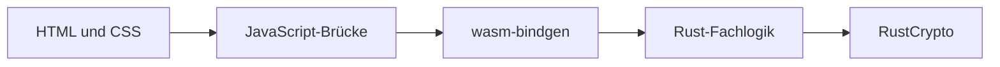

# Kryptographie mit Rust und WebAssembly

[](https://github.com/lindgreendavid/kryptographie-wasm/actions/workflows/ci.yml)
[](https://github.com/lindgreendavid/kryptographie-wasm/actions/workflows/pages.yml)

Eine deutschsprachige Lernanwendung, die drei klassische und zwei moderne Kryptographieverfahren interaktiv gegenüberstellt. Die Fachlogik läuft in Rust, wird als WebAssembly kompiliert und über kleine JavaScript-Brücken mit statischen HTML-Seiten verbunden.

**[Live-Demo öffnen](https://lindgreendavid.github.io/kryptographie-wasm/)**

## Abgabeangaben

| | |
| --- | --- |
| Bearbeiter | David Lindgreen (E039), Viktor Edelmann (E045) |
| Hochschule | Provadis Hochschule, Frankfurt am Main |
| Prüfer | Prof. Dr. Olaf Grebner |
| Projekt | Kryptographie mit Rust und WebAssembly |

> Dieses Projekt dient ausschließlich der Lehre. Caesar, Skytale und monoalphabetische Substitution sind nicht für reale Sicherheitsanwendungen geeignet. Auch die modernen Demonstrationen ersetzen keine geprüfte Produktarchitektur oder professionelles Schlüsselmanagement.

## Verfahren

| Verfahren | Kategorie | Demonstrierter Kern | Sicherheitsstatus |
| --- | --- | --- | --- |
| Caesar | Substitution | Feste Verschiebung im Alphabet | Historisch, leicht zu brechen |
| Skytale | Transposition | Zeichen bleiben erhalten, Positionen ändern sich | Historisch, leicht zu brechen |
| Monoalphabetische Substitution | Substitution | Frei wählbares Geheimalphabet | Historisch, durch Häufigkeitsanalyse angreifbar |
| AES-256-GCM | Authentifizierte Verschlüsselung | Geheimhaltung und Integritätsprüfung | Modern bei korrekter Verwendung |
| ChaCha20-Poly1305 | Authentifizierte Verschlüsselung | Stromchiffre mit Poly1305-Tag | Modern bei korrekter Verwendung |

Alle Verfahren unterstützen Verschlüsselung und Entschlüsselung. Validierungsfehler werden auf Deutsch ausgegeben. Die modernen Verfahren erzeugen kryptographisch zufällige 256-Bit-Schlüssel und 96-Bit-Nonces; manipulierte Daten werden über den Authentifizierungstag abgelehnt.

## Architektur



- `web/`: sechs statische Seiten, gemeinsame Gestaltung und DOM-Anbindung
- `src/crypto/`: ein Rust-Modul pro Verfahren
- `src/lib.rs`: klar abgegrenzte WebAssembly-Exports
- `tests/`: Roundtrip-, Validierungs- und Manipulationstests
- `docs/`: Spezifikationen, Architekturentscheidungen und Projektnachweise

Weitere Details stehen in der [Architekturdokumentation](docs/projekt-und-architektur.md).

## Schnellstart

### Voraussetzungen

- aktuelle stabile Rust-Version
- WebAssembly-Target `wasm32-unknown-unknown`
- `wasm-pack`
- Python 3 für den lokalen Webserver

```bash
rustup target add wasm32-unknown-unknown
cargo install wasm-pack
```

### Plattformunabhängig

```bash
./scripts/build.sh
./scripts/start.sh
```

### Windows PowerShell

```powershell
powershell -ExecutionPolicy Bypass -File .\scripts\build.ps1
powershell -ExecutionPolicy Bypass -File .\scripts\start.ps1
```

Danach ist die Anwendung unter `http://127.0.0.1:8080/index.html` erreichbar. Die HTML-Dateien sollten nicht direkt über `file://` geöffnet werden, weil Browser WebAssembly-Module dort blockieren können.

## Qualitätsprüfung

```bash
./scripts/test.sh
```

Der vollständige Prüfpfad umfasst:

```bash
cargo fmt --check
cargo clippy --all-targets --all-features -- -D warnings
cargo test --locked
wasm-pack build --target web --out-dir web/pkg
python3 scripts/verify_web.py
```

GitHub Actions führt dieselben Prüfungen bei jedem Push und Pull Request reproduzierbar aus. Die [Teststrategie](docs/teststrategie.md) beschreibt die Abdeckung und Grenzen.

## Nachvollziehbare Versionierung

Die aus sechs gelieferten Arbeitsständen rekonstruierte Entwicklung wurde bewusst feingranular organisiert. Kein Commit führt alle Verfahren gleichzeitig ein.

| Version | Inhalt |
| --- | --- |
| [`v0.0.1`](https://github.com/lindgreendavid/kryptographie-wasm/commit/fb452dcbc56b58fa438e64ea45cc8691c3a2ef8e) | Projektgrundlage, Rust, WebAssembly und statische Oberfläche |
| [`v0.1.0`](https://github.com/lindgreendavid/kryptographie-wasm/commit/2b919d65fe1fedcb315544a364f4a17805b8afb9) | Caesar-Chiffre |
| [`v0.2.0`](https://github.com/lindgreendavid/kryptographie-wasm/commit/9cfb24a54d4bcb8b68afeb51418c07691cc92685) | Skytale |
| [`v0.3.0`](https://github.com/lindgreendavid/kryptographie-wasm/commit/f01de6e8f1296fb9733b63847108307d9b1bfb8f) | Monoalphabetische Substitution |
| [`v0.4.0`](https://github.com/lindgreendavid/kryptographie-wasm/commit/651c13ada4701983112164661d20188e70e7d53d) | AES-256-GCM |
| [`v0.5.0`](https://github.com/lindgreendavid/kryptographie-wasm/commit/cb099440b6cc7da79aff773c2b0169f8489d2f27) | Hell- und Dunkelansicht |
| [`v0.6.0`](https://github.com/lindgreendavid/kryptographie-wasm/commit/8decec835e8c3a7b6d3ac6eb2266704c6e21fbe2) | Aktive Navigation und Tastaturfokus |
| [`v0.7.0`](https://github.com/lindgreendavid/kryptographie-wasm/commit/518379a7b9f4e72fec5d692027ff0b40316cda61) | Cyber-Ansicht und Projekt-Footer |
| [`v0.8.0`](https://github.com/lindgreendavid/kryptographie-wasm/commit/c65bb887ecf1bd7331790462c54aba6a28f6161e) | ChaCha20-Poly1305 |
| [`v0.9.0`](https://github.com/lindgreendavid/kryptographie-wasm/commit/6a29c477845d365e0b2840c16a25d0ddc8fc677b) | Gehärtete Zufalls- und Fehlerbehandlung |
| [`v1.0.0`](https://github.com/lindgreendavid/kryptographie-wasm/commit/cfb2bb6d22e6098d378957bbe7eee0043f6d681c) | Dokumentierte, geprüfte Abgabeversion |
| [`v1.0.1`](https://github.com/lindgreendavid/kryptographie-wasm/commit/1358b89486f3d8621f5d78434f6afef5864a639f) | Ergänzte Abgabe- und Autorenangaben |

Die [Versionshistorie](docs/versionshistorie.md) erklärt Rekonstruktion, Commit-Prinzipien und Meilensteine transparent. Änderungen der Abgabeversion stehen im [Changelog](CHANGELOG.md).

## Dokumentation

- [Projekt und Architektur](docs/projekt-und-architektur.md)
- [Technologieentscheidungen](docs/tech-stack.md)
- [Teststrategie](docs/teststrategie.md)
- [Spezifikationen](docs/specs/)
- [Architekturentscheidungen](docs/adr/)
- [Quellen](docs/quellen.md)
- [KI-Nutzung](docs/KI-Nutzung.md)
- [Abgabe-Checkliste](docs/abgabe-checkliste.md)

## Projektgrenzen

- Keine Benutzerkonten, Datenbank oder Serverkomponente
- Keine Speicherung von Texten, Schlüsseln oder Ergebnissen
- Nur A–Z/a–z werden durch Caesar und Substitution verändert; andere Zeichen bleiben erhalten
- Schlüssel werden zu Demonstrationszwecken im Browser angezeigt und nicht sicher verwaltet
- Nonces werden zufällig erzeugt; ein produktives System benötigt zusätzlich ein belastbares Konzept gegen Wiederverwendung

## Autor und Transparenz

Hochschulprojekt von **David Lindgreen (E039)** und **Viktor Edelmann (E045)** an der Provadis Hochschule. Codex wurde bei Strukturierung, Implementierung, Tests und Dokumentation eingesetzt. Umfang und Verantwortungsgrenzen sind in [KI-Nutzung.md](docs/KI-Nutzung.md) offengelegt.
