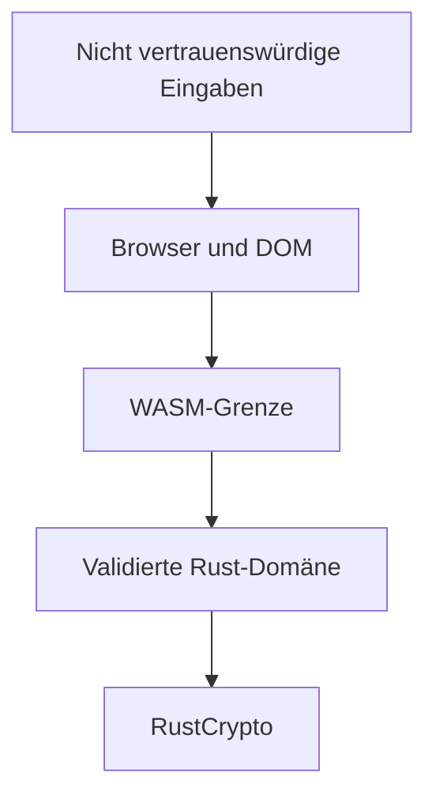

# Bedrohungsmodell

## Zweck und Geltungsbereich

Dieses Modell bewertet die Lernanwendung als statische Browseranwendung. Es beschreibt, was geschützt werden soll, welchen Eingaben nicht vertraut wird und welche Grenzen trotz technischer Maßnahmen verbleiben. Es ist kein Sicherheitsnachweis für einen produktiven Kryptodienst.

## Schutzwerte und Vertrauensgrenzen

| Schutzwert         | Ziel                                                          | Einordnung                                             |
| ------------------ | ------------------------------------------------------------- | ------------------------------------------------------ |
| Klartext           | während einer Operation nicht unbeabsichtigt verändern        | verbleibt ausschließlich im Browserprozess             |
| Schlüssel          | zufällig erzeugen und korrekt an das Verfahren übergeben      | wird zu Lehrzwecken sichtbar angezeigt                 |
| Nonce              | pro Operation zufällig erzeugen und in korrekter Länge nutzen | keine dauerhafte Eindeutigkeitsverwaltung              |
| Geheimtext und Tag | Manipulation beim Entschlüsseln erkennen                      | AEAD-Prüfung muss vor Klartextausgabe erfolgreich sein |
| Anwendungscode     | reproduzierbar bauen und Veränderungen prüfen                 | Git, Lockdateien, CI und gepinnte Actions              |

DOM-Eingaben, Base64-Werte und übertragene Geheimtexte gelten als nicht vertrauenswürdig. Erst die Längen-, Format- und Authentifizierungsprüfungen in Rust schaffen eine gültige fachliche Eingabe.

## Bedrohungen, Maßnahmen und Restrisiken

| Bedrohung                                     | Maßnahme                                               | Automatischer Nachweis                     | Restrisiko                                                           |
| --------------------------------------------- | ------------------------------------------------------ | ------------------------------------------ | -------------------------------------------------------------------- |
| manipuliertes AEAD-Ergebnis                   | Authentifizierung vor jeder Klartextausgabe            | Unit- und Browser-Manipulationstest        | kompromittierter Anwendungscode könnte die Prüfung umgehen           |
| falsche Schlüssel-, Nonce- oder Taglänge      | eigene Werttypen `Key32`, `Nonce12`, `AuthTag16`       | Negativtests mit konkreten Fehlervarianten | JavaScript zeigt Werte weiterhin offen an                            |
| schwacher Zufall                              | `getrandom` nutzt die Zufallsquelle des Browsers       | Größen- und Roundtriptests                 | Browserumgebung bleibt Teil der Vertrauensbasis                      |
| Nonce-Wiederverwendung                        | neue zufällige Nonce je Verschlüsselung                | Prüfung der Ausgabelänge                   | Zufall garantiert mathematisch keine globale Eindeutigkeit           |
| unsichere Eigenentwicklung moderner Primitive | AES-GCM und ChaCha20-Poly1305 aus RustCrypto           | NIST- und RFC-Known-Answer-Tests           | Bibliotheks- und Integrationsfehler bleiben möglich                  |
| manipulierte oder verwundbare Abhängigkeiten  | Lockdateien, RustSec, Dependabot, SHA-gepinnte Actions | Sicherheitsworkflow                        | neue Schwachstellen können erst nach Veröffentlichung bekannt werden |
| Cross-Site-Scripting durch Klartext           | Ausgabe über `textContent`, keine HTML-Interpretation  | Browser-Rundläufe und Codeprüfung          | zukünftige DOM-Änderungen müssen diese Regel bewahren                |
| unbemerkte Regression                         | Rust-, Struktur-, Browser- und WCAG-Tests              | GitHub Actions                             | automatisierte Tests ersetzen keine vollständige manuelle Prüfung    |

## Bewusste Nicht-Ziele

- kein Schutz vor einem bereits kompromittierten Browser oder Betriebssystem;
- keine Speicherung, Rotation oder Zugriffskontrolle für Schlüssel;
- kein Mehrbenutzerbetrieb und keine Netzwerkschnittstelle;
- keine Freigabe für reale vertrauliche Daten;
- keine Sicherheitsgarantie für Caesar, Skytale oder Substitution.

## Prüffragen für Änderungen

Bei jeder Erweiterung ist zu prüfen, ob neue Daten gespeichert oder übertragen werden, ob eine neue Vertrauensgrenze entsteht, ob Klartext vor erfolgreicher Authentifizierung sichtbar werden kann und ob zusätzliche Abhängigkeiten in RustSec beziehungsweise Dependabot aufgenommen werden müssen.
