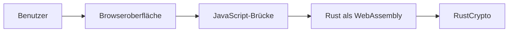
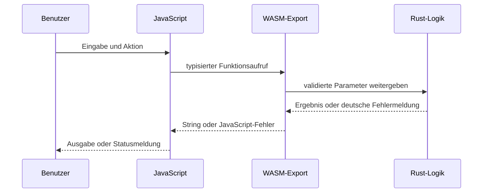

# Projekt- und Architekturdokumentation

**Bearbeiter:** David Lindgreen (E039), Viktor Edelmann (E045) 
**Hochschule:** Provadis Hochschule, Frankfurt am Main 
**Prüfer:** Prof. Dr. Olaf Grebner

## 1. Ziel und Lerngegenstand

Das Projekt ist eine deutschsprachige Lernanwendung für fünf Kryptographieverfahren. Es verfolgt zwei Ziele:

1. klassische Verfahren so darstellen, dass ihre Transformation nachvollziehbar bleibt;
2. moderne authentifizierte Verschlüsselung korrekt über etablierte Bibliotheken demonstrieren.

Die Anwendung stellt Caesar, Skytale und monoalphabetische Substitution den modernen AEAD-Verfahren AES-256-GCM und ChaCha20-Poly1305 gegenüber. Alle Verfahren können im Browser verschlüsseln und entschlüsseln.

## 2. Abgrenzung

Zum Projekt gehören Fachlogik, Weboberfläche, WebAssembly-Anbindung, Tests, Dokumentation und automatisierte Bereitstellung. Nicht zum Umfang gehören Benutzerkonten, Datenbank, Backend, dauerhafte Speicherung oder produktives Schlüsselmanagement.

Die Anwendung ist ausdrücklich kein Produkt für vertrauliche Daten. Schlüssel werden für die Demonstration sichtbar im Browser verarbeitet. Die historischen Verfahren besitzen keine zeitgemäße Sicherheit.

## 3. Qualitätsziele

| Qualitätsziel | Umsetzung |
| --- | --- |
| Nachvollziehbarkeit | ein Modul und eine Spezifikation pro Verfahren |
| Korrektheit | Beispiele, Roundtrips, Grenz- und Manipulationstests |
| Sicherheit der Demonstration | RustCrypto statt eigener Implementierung moderner Verfahren |
| Wartbarkeit | Rust-Fachlogik getrennt von DOM-Anbindung und Darstellung |
| Reproduzierbarkeit | Cargo-Lockdatei, festgelegte Rust-Version, Build-Skripte und CI |
| Zugänglichkeit | semantische Formulare, Tastaturfokus, Sprunglink, Statusbereiche und WCAG-Prüfung |
| Lieferkettenschutz | Lockdateien, RustSec, Dependabot und SHA-gepinnte Actions |

## 4. Systemkontext

Der Browser lädt statische HTML-, CSS- und JavaScript-Dateien. `wasm-bindgen` erzeugt die Bindings zwischen JavaScript und Rust. Nur AES-GCM und ChaCha20-Poly1305 greifen auf RustCrypto-Bibliotheken zurück; die klassischen Lehrverfahren sind überschaubar in Rust formuliert.

## 5. Komponenten und Verantwortlichkeiten

| Komponente | Verantwortung | Bewusst nicht enthalten |
| --- | --- | --- |
| `web/*.html` | Inhalte, Formulare, semantische Struktur | Kryptographielogik |
| `web/css/style.css` | responsives Layout und drei Ansichten | fachlicher Zustand |
| `web/js/*.js` | WASM laden, DOM-Helfer nutzen, Ergebnisse anzeigen | Verfahren implementieren |
| `src/lib.rs` | typisierte WASM-Schnittstelle und Fehlerübersetzung | DOM-Zugriff |
| `src/crypto/*.rs` | klassische Verschlüsselung und Validierung | Browserdarstellung |
| `src/crypto/aead/` | validierte Werttypen und getrennte moderne Verfahren | Schlüsselverwaltung |
| `tests/` und `e2e/` | fachliche, sicherheitsbezogene, Browser- und WCAG-Tests | vollständiges Sicherheitsaudit |
| `scripts/` | identische lokale Prüf- und Buildpfade | projektspezifische Installation |

## 6. Ablauf einer Operation

JavaScript enthält dadurch nur Integrationslogik. Fachliche Regeln wie Schlüsselbereiche, Alphabetprüfung und AEAD-Authentifizierung liegen testbar in Rust.

## 7. Datenformate

- Texte werden als UTF-8-Strings übergeben.
- Caesar und Substitution verändern nur ASCII-Buchstaben A–Z beziehungsweise a–z; andere Zeichen bleiben erhalten.
- AES- und ChaCha-Schlüssel enthalten 32 Byte und werden als Base64 dargestellt.
- Nonces enthalten 12 Byte, Authentifizierungstags 16 Byte.
- Moderne Verschlüsselungsergebnisse werden als typisiertes `WasmAeadResult` mit `ciphertext`, `nonce` und `tag` an JavaScript geliefert.

Die Aufteilung von Geheimtext und Tag dient der Lehre. RustCrypto verarbeitet beide Bestandteile bei der Authentifizierung wieder gemeinsam.

## 8. Fehlerbehandlung

Jede öffentliche Rust-Funktion liefert `Result`. Die Aufzählung `CryptoError` bildet Fehlerzustände strukturiert ab; Tests vergleichen dadurch Varianten statt Textfragmente. `Key32`, `Nonce12` und `AuthTag16` validieren kryptographische Längen an einer zentralen Grenze. `src/lib.rs` übersetzt Fehler erst für die Oberfläche in deutsche `JsValue`-Meldungen. Bei fehlgeschlagener Authentifizierung wird kein Klartext ausgegeben.

## 9. Sicherheitsentscheidungen

| Entscheidung | Begründung | verbleibende Grenze |
| --- | --- | --- |
| AES-GCM und ChaCha20-Poly1305 aus RustCrypto | geprüfte Primitive statt Eigenentwicklung | korrekte Einbindung ersetzt kein Produktkonzept |
| Zufall über `getrandom` | Browser-Zufallsquelle statt vorhersagbarer Werte | Nonce-Wiederverwendung muss produktiv systematisch verhindert werden |
| 256-Bit-Schlüssel | passende Schlüsselgröße beider moderner Verfahren | Schlüssel werden in der Demo sichtbar angezeigt |
| 96-Bit-Nonce und 128-Bit-Tag | Standardgrößen der verwendeten AEAD-Verfahren | keine Speicherung oder zentrale Nonce-Verwaltung |
| `#![forbid(unsafe_code)]` | vermeidet unsichere Rust-Blöcke im eigenen Code | Abhängigkeiten bleiben separat zu bewerten |

## 10. Oberflächen- und Zustandskonzept

Jedes Verfahren besitzt eine eigene Seite. Klassische Links ersetzen bewusst ein komplexes SPA-Routing. Formularwerte bleiben nur im DOM. Ausschließlich die Ansicht Hell, Dunkel oder Cyber wird in `localStorage` gespeichert; blockierter Browserspeicher wird abgefangen und beeinträchtigt die Fachfunktion nicht.

Die Oberfläche verwendet sichtbare Labels, semantische `output`-Elemente, `aria-live`-Statusbereiche, `aria-current` für die Navigation sowie einen Sprunglink zum Hauptinhalt.

## 11. Build und Bereitstellung

`wasm-pack build --target web --out-dir web/pkg` erzeugt das Browserpaket. `web/pkg/` und `target/` sind reproduzierbare Build-Artefakte und werden nicht versioniert.

GitHub Actions führt bei jeder Änderung Formatierung, Clippy, Rust-Tests, WASM-Build, HTML-Strukturprüfung, JavaScript-Syntaxprüfung und Playwright-Browsertests aus. Die Browserprüfung umfasst automatisierbare WCAG-A/AA-Regeln. Ein Sicherheitsworkflow prüft `Cargo.lock` mit RustSec; Dependabot überwacht Rust-, npm- und Action-Abhängigkeiten. Alle verwendeten Actions sind auf vollständige Commit-SHAs festgelegt.

Ein zweiter Workflow erstellt ein Release-Build und veröffentlicht ausschließlich den Ordner `web/` auf GitHub Pages. Beim Wechsel der Paketversion legt der Release-Workflow einen annotierten Git-Tag und ein GitHub-Release aus den versionierten Release Notes an.

## 12. Nachvollziehbare Entwicklung

Die sechs gelieferten Arbeitsstände wurden analysiert und in fachlich getrennte Commits überführt. Jedes neue Verfahren erhielt einen eigenen Meilenstein mit Rust-Modul, WASM-Export, Browseranbindung und Tests. Die Rekonstruktion ist in der [Versionshistorie](versionshistorie.md) ausdrücklich erläutert.

## 13. Bewusste Kompromisse

- Mehrseitiges HTML wiederholt die Navigation, bleibt dafür ohne Framework direkt lesbar.
- Base64 verbessert die Übertragbarkeit binärer Werte, ist aber keine Verschlüsselung.
- Zufällige Nonces sind für die Demonstration angemessen; produktiv wäre eine belastbare Strategie zur Eindeutigkeit nötig.
- Axe kontrolliert automatisierbare WCAG-Regeln, ersetzt aber keine vollständige Prüfung mit Screenreader und verschiedenen Browsern.

## 14. Sicherheits- und Entscheidungsnachweise

Das [Bedrohungsmodell](bedrohungsmodell.md) dokumentiert Schutzwerte, Vertrauensgrenzen, Maßnahmen und Restrisiken. Die ADRs 005 und 006 begründen das Fehlermodell, die AEAD-Werttypen sowie die Browser- und WCAG-Tests. Sinnvolle spätere Erweiterungen sind eine überwachte WASM-Größenbegrenzung, Cross-Browser-Tests und die didaktische Demonstration von Additional Authenticated Data.
