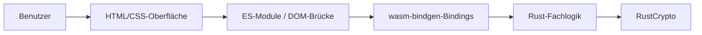
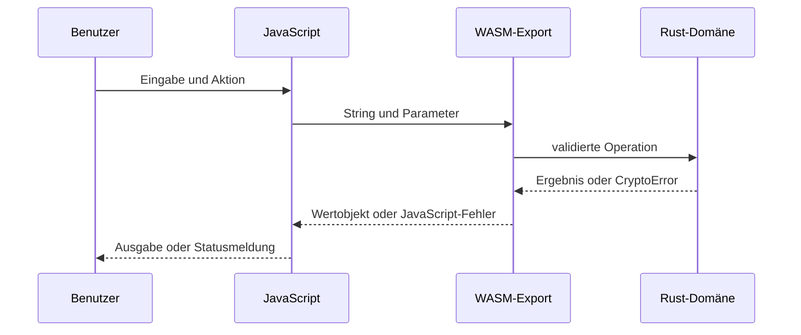

# Projekt- & Architekturdokumentation

| Dokument    | Angabe                                               |
| ----------- | ---------------------------------------------------- |
| Kurs        | Fortgeschrittene Programmierung, SoSe 2026           |
| Projekt     | Kryptographie mit Rust und WebAssembly               |
| Team        | David Lindgreen (E039), Viktor Edelmann (E045)       |
| Prüfer      | Prof. Dr. Olaf Grebner                               |
| Repository  | https://github.com/lindgreendavid/kryptographie-wasm |
| Deployment  | https://lindgreendavid.github.io/kryptographie-wasm/ |
| Abgabestand | Version 1.2.0, lokal geprüft am 23.08.2026           |

## 1. Anforderungen und Ziele

### Themensteckbrief

| Aspekt             | Inhalt                                                                                                                                |
| ------------------ | ------------------------------------------------------------------------------------------------------------------------------------- |
| Problem            | Historische und moderne Kryptographie sind ohne sichtbare Zwischenschritte schwer vergleichbar.                                       |
| Zielgruppe         | Studierende und Lehrende, die Verfahren direkt im Browser nachvollziehen möchten.                                                     |
| Lösung             | Eine deutschsprachige Lernanwendung stellt drei historische Verfahren zwei modernen AEAD-Verfahren gegenüber.                         |
| Kernfunktionen     | Ver- und Entschlüsseln, Parameter validieren, Tabellen bzw. Kryptoparameter erklären, Manipulation erkennen, drei Ansichten anbieten. |
| Fokus              | Rust als systemnahe Fachlogik, WebAssembly-Integration, Barrierefreiheit und reproduzierbare Qualitätssicherung.                      |
| Technischer Rahmen | Statische Mehrseiten-Web-App ohne Backend, Datenbank oder externe Laufzeitanfragen.                                                   |
| Erfolgskriterium   | Alle fünf Roundtrips funktionieren über reales WASM; Tests, Linter, Typecheck, Coverage, Build, E2E und Lighthouse sind grün.         |

Die vollständige prüfbare Zuordnung von Anforderungen zu Code und Tests steht in der
[Anforderungs- und Nachweismatrix](anforderungsmatrix.md). Alle Muss-Anforderungen sind umgesetzt.

### Abgrenzung

Zum Umfang gehören Fachlogik, Weboberfläche, WASM-Brücke, Tests, Dokumentation und statische
Bereitstellung. Nicht zum Umfang gehören Benutzerkonten, Backend, Datenbank, dauerhafte
Datenspeicherung, produktives Schlüsselmanagement und eine eigene Implementierung moderner
Kryptographie. Die Anwendung verarbeitet Texte und Schlüssel lokal im Browser.

Caesar, Skytale und monoalphabetische Substitution sind historische Lernverfahren und nicht sicher.
AES-256-GCM und ChaCha20-Poly1305 verwenden etablierte RustCrypto-Bibliotheken, ersetzen aber ohne
Schlüsselverwaltung, Nonce-Konzept und Sicherheitsaudit keine Produktlösung.

### Qualitätsziele

| Ziel               | Messkriterium                                                        | Ist-Nachweis                                |
| ------------------ | -------------------------------------------------------------------- | ------------------------------------------- |
| Korrektheit        | bekannte Beispiele, offizielle Vektoren, Roundtrips und Negativfälle | 27/27 Rust-Tests                            |
| Robustheit         | ungültige Eingaben und manipulierte AEAD-Daten ohne Klartextausgabe  | Rust- und E2E-Negativtests                  |
| Wartbarkeit        | Format, Lint, Typecheck, Clippy und Rustdoc ohne Fehler              | reproduzierbare npm-/Cargo-Skripte          |
| Testabdeckung      | mindestens 85 % Rust-Zeilenabdeckung                                 | 98,82 % Lines, 95,99 % Regions              |
| Zugänglichkeit     | keine automatisierbaren WCAG-A/AA-Verstöße                           | 6 Seiten × 3 Ansichten mit axe              |
| Webqualität        | Lighthouse Desktop mindestens 90; Accessibility 100                  | 100/100 in allen vier Kategorien            |
| Reproduzierbarkeit | Lockfiles und festgelegte Toolchain                                  | Rust 1.97.1, wasm-pack 0.14.0, npm lockfile |

## 2. Technologie-Stack

| Schicht               | Technologie                                                                  | Entscheidung                                        |
| --------------------- | ---------------------------------------------------------------------------- | --------------------------------------------------- |
| Oberfläche            | HTML5, CSS3                                                                  | semantisch, direkt lesbar, kein unnötiges Framework |
| Integration           | Vanilla JavaScript als ES-Module                                             | nur DOM, Zustände und WASM-Aufrufe                  |
| Fachlogik             | Rust 1.97.1, Edition 2021                                                    | typisierte, nativ testbare Domäne                   |
| Browserziel           | WebAssembly über wasm-bindgen/wasm-pack 0.14.0                               | kleine explizite Schnittstelle                      |
| moderne Kryptographie | RustCrypto: aes-gcm, chacha20poly1305                                        | keine selbst entwickelte Primitive                  |
| Qualität              | Cargo, rustfmt, Clippy, Rustdoc, ESLint, JSDoc, TypeScript checkJs, Prettier | Compiler- und Linter-Gates für beide Schichten      |
| Tests                 | cargo test, cargo-llvm-cov, Playwright, axe-core, Lighthouse                 | Core, Integration und reale Browserflows            |
| Auslieferung          | GitHub Actions und GitHub Pages                                              | statisches, reproduzierbares Deployment             |

Vanilla JavaScript bleibt bewusst erhalten. TypeScript 7 prüft die JavaScript-Module im strikten
checkJs-Modus anhand von JSDoc-Typen. Damit erhält das kleine Frontend Typprüfung ohne Migration,
Bundler oder duplizierten Quellcode.

## 3. Systemkontext und Bausteine



| Baustein                         | Verantwortung                                           | Nicht verantwortlich für       |
| -------------------------------- | ------------------------------------------------------- | ------------------------------ |
| `web/*.html`                     | semantische Inhalte, Eingaben, Ausgaben, Navigation     | kryptographische Regeln        |
| `web/css/style.css`              | responsive Gestaltung, Fokus, drei Ansichten            | fachlicher Zustand             |
| `web/js/theme.js`                | Ansicht und fehlertolerante localStorage-Persistenz     | Kryptographie                  |
| `web/js/dom.js`                  | typsichere DOM-Helfer und Ladezustände                  | Verfahrenslogik                |
| verfahrensspezifische JS-Dateien | Ereignisse binden, WASM aufrufen, Ergebnisse anzeigen   | algorithmische Berechnung      |
| `src/lib.rs`                     | 16 dokumentierte WASM-Exports und Fehlerübersetzung     | DOM-Zugriff                    |
| `src/crypto/*.rs`                | historische Verfahren, Validierung, Fehlerdomäne        | Browserdarstellung             |
| `src/crypto/aead/`               | Schlüssel-/Nonce-/Tagtypen und getrennte AEAD-Verfahren | Schlüsselverwaltung            |
| `tests/`, `e2e/`                 | Core-, API-, Browser- und WCAG-Nachweis                 | vollständiges Sicherheitsaudit |

Die Fachlogik ist nativ testbar und kennt den Browser nicht. Die Oberfläche kennt keine
Kryptographieimplementierung. Dieser Schnitt hält die WASM-Grenze klein und verhindert zwei
widersprüchliche Implementierungen desselben Verfahrens.

## 4. Frontend

### Seiten, Routing und Zustand

Die Anwendung umfasst eine Startseite und je eine Seite für Caesar, Skytale, Substitution, AES und
ChaCha20. Normale Links ersetzen ein SPA-Routing. Das reduziert Abhängigkeiten und lässt jede Route
direkt öffnen. Formularzustände bleiben absichtlich im DOM; lediglich Hell-, Dunkel- oder
Cyber-Ansicht wird in `localStorage` gespeichert.

Alle Verfahren zeigen während der WASM-Initialisierung einen Status und deaktivieren ihre
Aktionsschaltflächen. Erst nach erfolgreichem Laden werden die Controls freigegeben. Ein Ladefehler
bleibt sichtbar und kann nicht zu stillen No-op-Aktionen führen.

### Bedienbarkeit und Barrierefreiheit

- sichtbare Labels für Eingabe- und Ausgabefelder;
- semantische `main`-, `nav`- und `output`-Elemente;
- Sprunglink mit programmatischer Fokusübernahme;
- `aria-current` für die aktive Route und `aria-live` für Statusmeldungen;
- sichtbare Fokusrahmen und robuste Kontraste in drei Ansichten;
- responsive Layouts ohne horizontalen Dokument-Overflow bei 390 Pixeln.

Axe prüft alle sechs Seiten in allen drei Ansichten gegen automatisierbare WCAG-A/AA-Regeln.
Playwright prüft zusätzlich Tastaturfluss, aktive Navigation, Mobile-Layout und Browserkonsole.
Manuelle Screenreader- und Mehrbrowserprüfungen bleiben eine transparente Grenze.

## 5. Rust und kryptographische Fachlogik

### Historische Verfahren

Caesar verschiebt ausschließlich ASCII-Buchstaben und erhält Zahlen, Satzzeichen, Umlaute und Emoji.
Skytale ordnet Unicode-Zeichen in einer Matrix an und rekonstruiert unvollständige letzte Zeilen.
Substitution akzeptiert genau eine Permutation der 26 lateinischen Großbuchstaben. Diese Regeln sind
zentral in Rust validiert; JavaScript wiederholt sie nicht.

### Moderne Verfahren

AES-256-GCM und ChaCha20-Poly1305 sind getrennte Module mit einer gemeinsamen Datenform. Schlüssel
umfassen 32 Byte, Nonces 12 Byte und Tags 16 Byte. Binärwerte werden als Base64 dargestellt. Der
Zufall stammt über `getrandom` aus der Browserquelle. Bei falschem Schlüssel, veränderten Daten,
Nonce oder Tag schlägt die Authentifizierung fehl und es wird kein Klartext ausgegeben.

`Key32`, `Nonce12` und `AuthTag16` validieren Größen genau einmal an der Domänengrenze.
`CryptoError` trennt ungültige Parameter, Base64-/UTF-8-Fehler und fehlgeschlagene Authentifizierung.
`src/lib.rs` übersetzt die strukturierte Rust-Fehlerdomäne erst an der WASM-Grenze in verständliche
deutsche Meldungen.

Der eigene Rust-Code verbietet `unsafe` über `#![forbid(unsafe_code)]`. Zusätzlich erzwingt
`#![deny(missing_docs)]` Dokumentation für die öffentliche API. Offizielle NIST- und RFC-8439-
Testvektoren prüfen die moderne Einbindung unabhängig von selbst erzeugten Roundtrip-Daten.

## 6. Frontend-/WASM-Integration



Strings werden als UTF-8 übergeben. Moderne Ergebnisse erscheinen als typisiertes
`WasmAeadResult` mit `ciphertext`, `nonce` und `tag`. Die Aufteilung ist didaktisch; RustCrypto
authentifiziert Geheimtext und Tag wieder gemeinsam. Ein Browser-E2E-Test durchläuft die reale Kette
von HTML über JavaScript und WASM bis Rust und zurück; die Bindings werden nicht gemockt.

## 7. Tooling, Build und Deployment

Der komplette lokale Qualitätslauf lautet:

```bash
npm ci
npx playwright install chromium
npm run test:all
```

`test:all` führt Rustformatierung, Clippy, 27 Rust-Tests, vollständige Rustdoc-Prüfung, eine
Coverage-Schranke von 85 %, Release-WASM-Build, Strukturprüfung, Prettier, ESLint, Typecheck,
18 Playwright-/WCAG-Tests und Lighthouse aus. Einzelne Gates sind als benannte npm-Skripte
ausführbar. PowerShell- und Shell-Skripte stellen denselben Einstieg unter Windows, Linux und macOS
bereit.

GitHub Actions wiederholt diesen Pfad bei Push und Pull Request. Berichte für Coverage, Playwright
und Lighthouse werden als CI-Artefakte gesichert. Ein separater Pages-Workflow baut mit derselben
Rust- und wasm-pack-Version und veröffentlicht ausschließlich `web/`. Releases sind absichtlich
manuell; der Workflow erzeugt nur den aktuellen geprüften Tag und keine künstlichen historischen
Tags.

## 8. Qualität und Messergebnisse

Messstand: lokaler Release-Build vom 23.08.2026.

| Kennzahl                                   |                        Wert |
| ------------------------------------------ | --------------------------: |
| Rust-Produktionsdateien / Zeilen           |                    10 / 937 |
| Rust-Integrationstestdateien / Zeilen      |                     2 / 468 |
| JavaScript-Dateien / Zeilen                |                     9 / 589 |
| Browser-Testdateien / Zeilen               |                     1 / 170 |
| Rust-Tests                                 |                27 bestanden |
| Browser-/WCAG-Tests                        |                18 bestanden |
| WASM-Exports                               |                          16 |
| eigene `unsafe`-Blöcke                     |                           0 |
| Rust Coverage: Regions / Functions / Lines | 95,99 % / 97,62 % / 98,82 % |
| WASM Release roh / gzip                    |        87.993 / 35.663 Byte |
| erzeugte JS-Bindings roh / gzip            |         26.535 / 4.583 Byte |
| Lighthouse Desktop Startseite              |       100 / 100 / 100 / 100 |
| Lighthouse Desktop AES                     |       100 / 100 / 100 / 100 |

Die Coverage wird auf Windows ARM wegen eines dokumentierten LLVM-Profilfehlers automatisiert über
das x86_64-Rust-Ziel gemessen. Dadurch bleibt die Messung reproduzierbar, ohne den nativen Build oder
die Anwendungsarchitektur zu verändern.

## 9. Projektverlauf, Kapazität und Entscheidungen

Die Kursvorgabe kalkuliert 40 Stunden je Studierendem. Für zwei Teammitglieder ergibt sich ein
Planbudget von 80 Stunden:

| Arbeitspaket                     | Plan [Teamstunden] | Ist                              |
| -------------------------------- | -----------------: | -------------------------------- |
| Anforderungen, Specs und Planung |                 10 | aus realem Zeitnachweis ergänzen |
| Frontend und UX                  |                 16 | aus realem Zeitnachweis ergänzen |
| Rust-/WASM-Fachlogik             |                 24 | aus realem Zeitnachweis ergänzen |
| Integration und Fehlerbehandlung |                 10 | aus realem Zeitnachweis ergänzen |
| Tests, Tooling und CI            |                 12 | aus realem Zeitnachweis ergänzen |
| Dokumentation und Präsentation   |                  8 | aus realem Zeitnachweis ergänzen |
| **Gesamt**                       |             **80** | **nicht nachträglich erfunden**  |

Die tatsächlichen Stunden sind keine technische Messgröße und lassen sich nicht seriös aus
Dateizeitstempeln oder einer rekonstruierten Git-Historie ableiten. Deshalb bleiben sie bis zur
Ergänzung durch David und Viktor bewusst offen. Die Ausfüllhilfe steht in
[zeitnachweis.md](zeitnachweis.md).

Wesentliche Entscheidungen sind als ADRs dokumentiert: Rust/WASM, Vanilla HTML/CSS/JS, AES-GCM,
ChaCha20-Poly1305, strukturierte Fehler/Werttypen sowie Browser-/WCAG-Tests. Die sechs gelieferten
Arbeitsstände wurden fachlich geordnet; diese rekonstruierte Historie wird ausdrücklich nicht als
ursprünglicher zeitlicher Verlauf ausgegeben.

## 10. Herausforderungen und Lessons Learned

| Herausforderung                | Lösung                                                      | Erkenntnis                                                                   |
| ------------------------------ | ----------------------------------------------------------- | ---------------------------------------------------------------------------- |
| sichere moderne Kryptographie  | RustCrypto und offizielle Testvektoren                      | Primitive nicht selbst implementieren; Einbindung trotzdem unabhängig prüfen |
| binäre AEAD-Werte im Browser   | typisierte Rust-Werte und Base64 nur als Darstellung        | Encoding klar von Verschlüsselung trennen                                    |
| flüchtige WASM-Initialisierung | sichtbarer Ladezustand und deaktivierte Controls            | asynchrone Grenzen brauchen einen testbaren UI-Zustand                       |
| stabile Browsertests           | reale Zustände abwarten und Workerzahl begrenzen            | Determinismus ist wichtiger als maximale Parallelität                        |
| Coverage auf Windows ARM       | automatischer x86_64-Mess-Fallback                          | Toolchainfehler transparent kapseln, Messmethode dokumentieren               |
| Abhängigkeitsqualität          | exakte Versionen, Lockfiles, Audit und SHA-gepinnte Actions | Reproduzierbarkeit ist Teil der Produktqualität                              |
| KI-Unterstützung               | Specs, Reviews und ausführbare Gates                        | generierten Inhalt nie ungeprüft als Ergebnis ausgeben                       |

## 11. Abschlussabgleich

| Prüffrage                                         | Status / Nachweis                                       |
| ------------------------------------------------- | ------------------------------------------------------- |
| Läuft das Projekt mit dokumentierten Befehlen?    | ja, Build und lokaler Server geprüft                    |
| Sind alle Muss-Anforderungen umgesetzt?           | ja, siehe Anforderungsmatrix                            |
| Passen Dokument und Quellcode zusammen?           | ja, Messstand 23.08.2026                                |
| Sind Frontend und WASM reproduzierbar?            | ja, Lockfiles, Toolchain und CI                         |
| Sind Linter, Formatter, Typecheck und Tests grün? | ja, finaler lokaler Qualitätslauf                       |
| Ist die reale WASM-Integration getestet?          | ja, 18 Playwright-Szenarien ohne Mocks                  |
| Sind Einschränkungen transparent?                 | ja, Abgrenzung, Bedrohungsmodell und offene Ist-Stunden |

Der technische Stand ist abgabereif. Vor dem finalen Upload müssen nur die persönlichen
Ist-Zeitwerte ergänzt, der endgültige Commit/Tag eingetragen und die Präsentation einmal unter realen
Vorführbedingungen geprobt werden.
