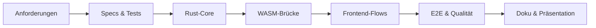

# Projektplan

## Rahmen und Ziel

Die Kursvorgabe sieht rund 40 Stunden je Studierendem vor. Für das Zweierteam wurde der Scope deshalb
auf fünf vollständig demonstrierbare Verfahren, eine klare Rust-/WASM-Grenze und nachweisbare
Qualität begrenzt. Backend, Konten, Datenbank und produktive Schlüsselverwaltung bleiben außerhalb.

## Arbeitspakete

| Phase                            | Plan [Team-h] | Ergebnis / Akzeptanzkriterium                                   |
| -------------------------------- | ------------: | --------------------------------------------------------------- |
| Analyse, Specs und Planung       |            10 | Verfahren, Inputs, Outputs, Fehler und Tests sind spezifiziert. |
| Frontend und UX                  |            16 | sechs responsive, tastaturtaugliche Seiten mit drei Ansichten   |
| Rust-/WASM-Fachlogik             |            24 | fünf Verfahren, typsichere AEAD-Werte, 16 dokumentierte Exports |
| Integration und Fehlerbehandlung |            10 | reale Roundtrips, Ladezustände, verständliche Fehler            |
| Tests, Tooling und CI            |            12 | Lint, Typecheck, Coverage, E2E, axe, Lighthouse, Actions        |
| Dokumentation und Präsentation   |             8 | Bericht, ADRs, Demo-Drehbuch, Folien und Abgabecheck            |
| **Gesamt**                       |        **80** | technisch und dokumentarisch konsistenter Abgabestand           |

Die tatsächlichen Stunden müssen die Teammitglieder aus ihren realen Aufzeichnungen in
[zeitnachweis.md](zeitnachweis.md) ergänzen. Eine nachträgliche Schätzung wird nicht als Ist-Wert
ausgegeben.

## Abhängigkeiten und Reihenfolge

## Risiken und Maßnahmen

| Risiko                           | Eintritt / Auswirkung | Maßnahme                                              | Rest-Risiko                            |
| -------------------------------- | --------------------- | ----------------------------------------------------- | -------------------------------------- |
| moderne Kryptographie fehlerhaft | mittel / sehr hoch    | RustCrypto + NIST-/RFC-Vektor                         | Einbindung ist Demo, kein Audit        |
| Nonce/Schlüssel missverstanden   | mittel / hoch         | getrennte Felder, Erklärungen, Bedrohungsmodell       | sichtbare Schlüssel in Demo            |
| WASM lädt verzögert              | mittel / mittel       | Ladezustand und gesperrte Controls                    | Netz-/Browserfehler bleibt möglich     |
| Testflakiness                    | mittel / mittel       | zustandsbasiertes Warten, 2 Worker, Diagnoseartefakte | weitere Browser nicht automatisiert    |
| Toolchainabweichung              | mittel / hoch         | exakte Versionen, Lockfiles, CI                       | externe Action-/Registry-Verfügbarkeit |
| Scope wächst kurz vor Abgabe     | hoch / hoch           | keine neuen Verfahren, kein Backend/PWA               | nur bewertungsrelevante Fehler beheben |

## Meilensteine

1. Anforderungen und Architektur festlegen.
2. Historische Verfahren vollständig machen.
3. Moderne AEAD-Verfahren über Bibliotheken einbinden.
4. Browserintegration, Responsiveness und Accessibility absichern.
5. Tooling, Coverage, CI und Deployment reproduzierbar machen.
6. Bericht, Präsentation und Demo aus dem finalen Messstand erzeugen.
7. Final Freeze: nur noch nachweisbare Fehler korrigieren.

## Definition of Done

Der Stand ist technisch fertig, wenn `npm run test:all` erfolgreich ist, alle Muss-Anforderungen
in der Nachweismatrix umgesetzt sind und Bericht, Code und Messwerte übereinstimmen. Organisatorisch
fertig ist die Abgabe erst nach Ergänzung realer Ist-Stunden, finalem Git-Commit/Tag, Upload und einer
geprobten Sieben-Minuten-Präsentation.
